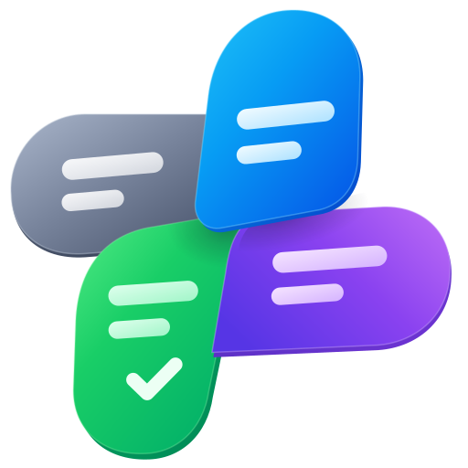
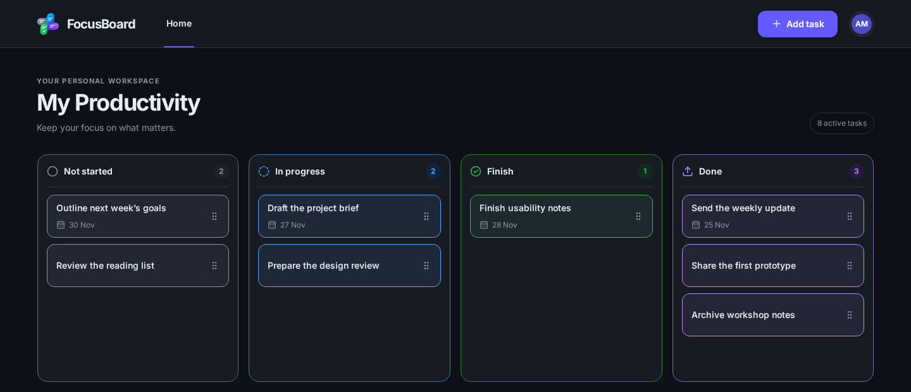
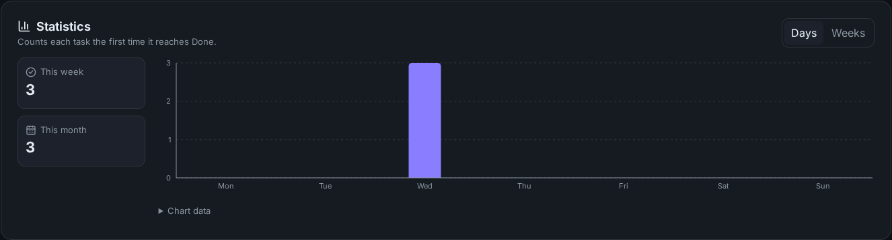
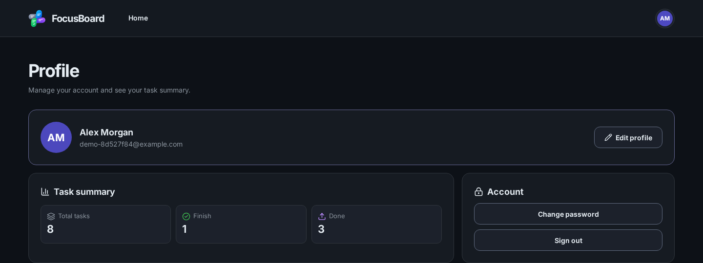
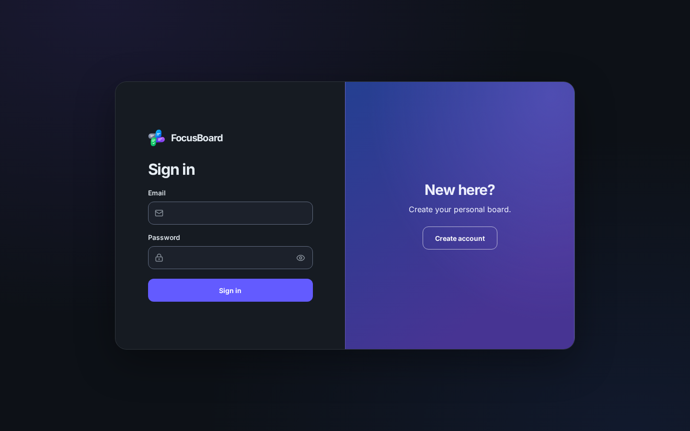
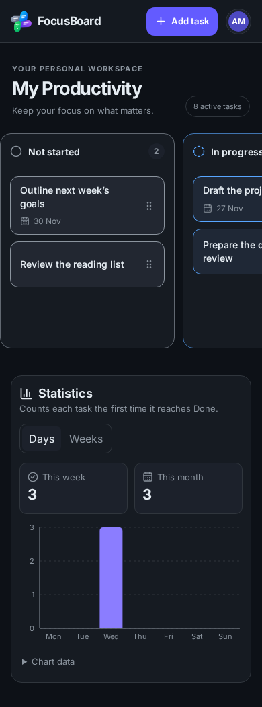
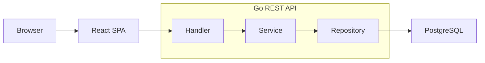

<div align="center">
  
  <h1>FocusBoard</h1>
  <p>Organize your tasks. Stay focused. Track your progress.</p>

  <a href="https://github.com/parzij/focusboard/actions/workflows/ci.yml"></a>
  
  
  
  
</div>

## About

FocusBoard is a personal web app for organizing tasks, managing your workflow, and tracking your productivity. Its minimal, GitHub-inspired dark workspace keeps planning, execution, and progress visible on desktop and mobile.

## Features

- Personal Kanban board with **Not started**, **In progress**, **Finish**, and **Done**.
- Create, edit, and delete tasks with descriptions and optional due dates.
- Reorder cards by mouse, touch, or keyboard. PostgreSQL persists their order.
- View daily and weekly charts alongside current week and month completion totals.
- Register, sign in, edit your profile, change your password, and sign out.
- Use a responsive workspace with an independently scrollable Kanban board on mobile.

**Active tasks** counts the cards currently on your board. **Statistics** counts each task when it first reaches Done. Finish does not count as a completion. Reopening, closing again, or deleting a previously completed task does not erase or duplicate its first completion.

## Screenshots



| Statistics | Profile |
| --- | --- |
|  |  |

| Authentication | Mobile workspace |
| --- | --- |
|  |  |

## Technology Stack

| Layer | Tools |
| --- | --- |
| Frontend | React, TypeScript, Vite, Tailwind CSS, TanStack Query, React Router, React Hook Form, Zod, dnd-kit, Recharts, Lucide React |
| Backend | Go, Chi, PostgreSQL, pgx, Goose, JWT, Argon2id |
| Infrastructure and testing | Docker, Docker Compose, GitHub Actions, OpenAPI, Vitest, Playwright, Go testing |

## Architecture



For local development, Vite serves the SPA and proxies same-origin API requests. Compose starts PostgreSQL, runs Goose migrations, then starts the API.

## Getting Started

You need Git, Docker with Compose v2, Node.js 24 or 26, pnpm 11.6.0, and OpenSSL. Go 1.27 is needed only for running Go checks on the host.

```sh
git clone https://github.com/parzij/focusboard.git
cd focusboard
cp .env.example .env
openssl rand -base64 32
```

Set `JWT_SECRET` in `.env` to the generated value. Keep the local origin `http://127.0.0.1:5173`, API port `8080`, and `COOKIE_SECURE=false` for local HTTP. If you change `POSTGRES_PASSWORD`, update the password in `DATABASE_URL` to match. Keep `.env` private.

```sh
docker compose config --quiet
docker compose up --build -d
curl -fsS --retry 10 --retry-connrefused --retry-all-errors http://127.0.0.1:8080/api/v1/ready

cd frontend
pnpm install --frozen-lockfile
pnpm dev --host 127.0.0.1 --port 5173 --strictPort
```

Open [http://127.0.0.1:5173/auth](http://127.0.0.1:5173/auth) and create an account. To stop, exit Vite with Ctrl+C and run `docker compose down` from the repository root. The named PostgreSQL volume is retained.

## Security

Passwords use Argon2id. The SPA stores the access JWT in memory, and refresh tokens rotate through an HttpOnly cookie. The API derives the account owner from the validated JWT, scopes database access to that owner, uses parameterized SQL, and serializes task changes in transactions. Authentication endpoints use rate limiting.

## Testing

```sh
(cd backend && go mod verify && go vet ./... && go test -race ./... && go build ./...)
(cd frontend && pnpm lint && pnpm format:check && pnpm typecheck && pnpm test && pnpm build)
bash scripts/test-compose.sh
```

To run the Go PostgreSQL integration suite locally, set `FOCUSBOARD_TEST_DATABASE_URL` to a dedicated test database. The Compose script checks startup, migrations, persistence, and authentication, tasks, and statistics over HTTP.

Stop the local API and Vite first so the isolated Playwright stack can use ports 8080 and 5173.

```sh
(cd frontend && pnpm exec playwright install chromium)
bash scripts/test-frontend-e2e.sh
```

## Documentation

- [Specification](SPECIFICATION.md) · [Contributor instructions](AGENTS.md)
- [Architecture](docs/ARCHITECTURE.md) · [Database](docs/DATABASE.md)
- [REST API](docs/API.md) · [OpenAPI contract](docs/openapi.yaml)
- [Design system](docs/DESIGN_SYSTEM.md) · [Technical decisions](docs/DECISIONS.md)
- [Roadmap](docs/ROADMAP.md) · [Changelog](docs/CHANGELOG.md)

## Deployment Status

The functional MVP is complete. Production deployment and release are in preparation. Caddy, public DNS and HTTPS, and the production release workflow are part of the next stage. See the [preliminary deployment plan](docs/DEPLOYMENT_PLAN.md).
