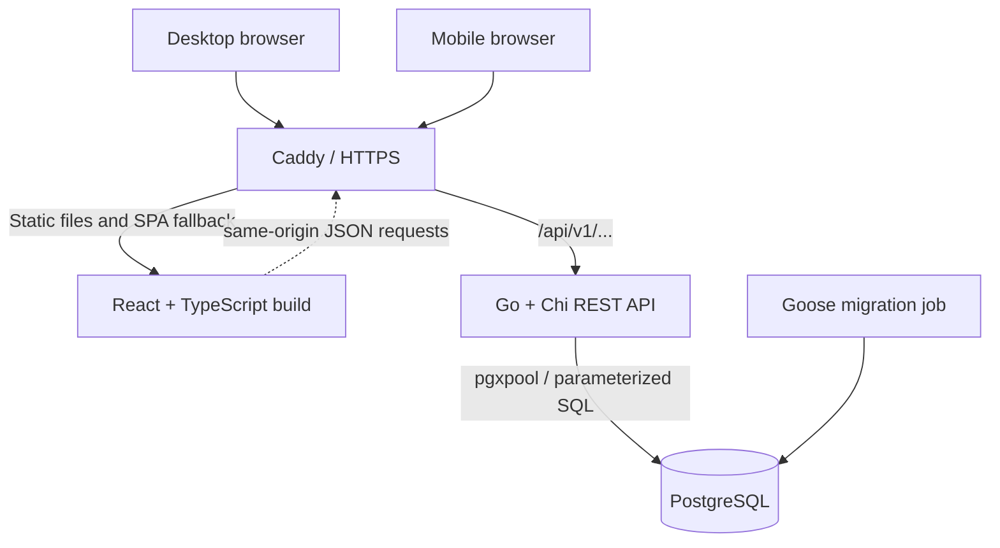
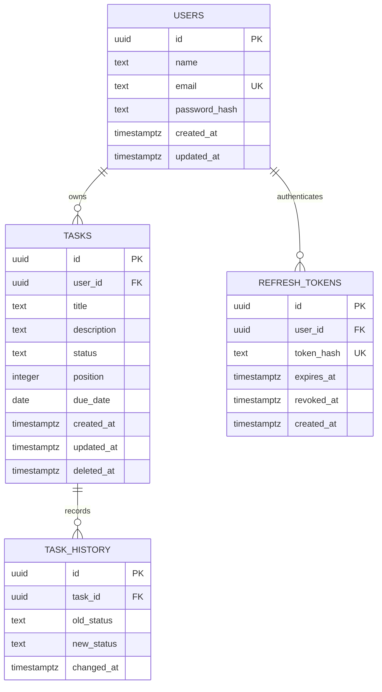

# FocusBoard — техническое задание

**Версия:** 1.0 · **Статус:** базовое ТЗ для разработки · **Язык интерфейса:** English · **Язык документации:** русский  
**Тип продукта:** персональное веб-приложение (SPA), desktop + mobile  
**Адресат:** разработчик и Codex (агент разработки)

> Этот файл — основной источник требований к проекту. Реализовать работающее приложение, а не только демонстрационный интерфейс. Утверждённые технологии, названия статусов и визуальная концепция обязательны. Предложенные ниже технические детали, не оговорённые ранее отдельно, являются рабочими решениями для MVP; при существенном изменении согласовать их с владельцем проекта. Макеты задают визуальный стиль, а это ТЗ — точное поведение и терминологию. При расхождении текста в старом макете и ТЗ использовать ТЗ.

## Содержание

1. [Продукт и границы MVP](#1-продукт-и-границы-mvp)
2. [Технологический стек](#2-технологический-стек)
3. [Архитектура](#3-архитектура)
4. [Структура репозитория](#4-структура-репозитория)
5. [Модель данных и PostgreSQL](#5-модель-данных-и-postgresql)
6. [Бизнес-логика задач](#6-бизнес-логика-задач)
7. [Авторизация и безопасность](#7-авторизация-и-безопасность)
8. [REST API](#8-rest-api)
9. [Дизайн-система](#9-дизайн-система)
10. [Вход и регистрация — единый анимированный экран](#10-вход-и-регистрация--единый-анимированный-экран)
11. [Главная страница и Kanban](#11-главная-страница-и-kanban)
12. [Модальные окна](#12-модальные-окна)
13. [Профиль](#13-профиль)
14. [Статистика](#14-статистика)
15. [Адаптивность, анимации и доступность](#15-адаптивность-анимации-и-доступность)
16. [Frontend: состояние и работа с API](#16-frontend-состояние-и-работа-с-api)
17. [Инфраструктура и развёртывание](#17-инфраструктура-и-развёртывание)
18. [Тестирование и CI](#18-тестирование-и-ci)
19. [План реализации](#19-план-реализации)
20. [Критерии приёмки](#20-критерии-приёмки)
21. [Правила работы Codex](#21-правила-работы-codex)
22. [Визуальные референсы](#22-визуальные-референсы)

---

## 1. Продукт и границы MVP

### 1.1. Идея

FocusBoard — личный менеджер задач, ориентированный на учёбу, разработку и повседневные дела. Пользователь быстро создаёт задачу, переносит её между этапами выполнения, фиксирует сдачу/закрытие и наблюдает за собственной продуктивностью. Это не командная система управления проектами, не аналог Jira со множеством настроек и не календарь.

Главные принципы: минимум элементов UI, понятное состояние задач с первого взгляда, плавное взаимодействие, единая тёмная тема в духе GitHub, удобство на ноутбуке и телефоне, сохранение данных между сессиями и устройствами. Внутреннюю реализацию строить качественно, но без архитектурного усложнения ради усложнения.

### 1.2. Функции MVP

- Регистрация, вход, восстановление сессии после перезагрузки страницы, выход из аккаунта.
- Один аккаунт — одна персональная доска. Несколько аккаунтов поддерживаются, но не имеют общих задач.
- Создание, просмотр, редактирование и удаление задач.
- Ровно четыре фиксированных статуса и четыре колонки. Пользователь не создаёт, не удаляет и не переименовывает колонки.
- Перетаскивание карточек между колонками и изменение их порядка внутри одной колонки. Изменения сохраняются на сервере.
- Название, необязательное описание, необязательный дедлайн и статус каждой задачи.
- Статистика завершённых задач по дням и неделям, небольшие сводные показатели.
- Профиль, изменение имени и пароля, выход из аккаунта.
- Адаптивный дизайн, состояния загрузки, пустые состояния, обработка ошибок.

### 1.3. Вне MVP

PWA (установка на домашний экран) — этап 2, после стабильного MVP. Push/email-напоминания, восстановление пароля по почте, подтверждение email, аватары с загрузкой файла, смена email, совместные доски, роли, теги, приоритеты, вложения, календарь, интеграции, offline-редактирование и realtime через WebSocket/SSE не входят в первую версию. Наличие элемента на старом макете не означает, что его нужно реализовать как неработающую кнопку. Не добавлять заглушки для отложенных функций.

## 2. Технологический стек

### 2.1. Backend

| Технология | Роль и обоснование |
|---|---|
| Go | Основной язык сервера; компактный, типизированный, хорошо подходит для REST API |
| Chi (`github.com/go-chi/chi/v5`) | Маршрутизация, группы маршрутов, middleware |
| PostgreSQL | Постоянное хранение пользователей, задач, сессий и истории |
| pgx / pgxpool | Драйвер, пул подключений, транзакции PostgreSQL |
| SQL | Ручные параметризованные запросы, без ORM |
| Goose | Версионированные SQL-миграции, Up/Down |
| JWT | Короткоживущий access token для авторизации API |
| Access + Refresh tokens | Продление сессии без повторного ввода пароля |
| Argon2id | Хеширование паролей с уникальной случайной солью |
| `log/slog` | Структурированные логи |
| REST / JSON | Контракт взаимодействия клиента и сервера |
| OpenAPI / Swagger UI | Документация и проверка контракта |
| Go `testing`, `httptest` | Unit- и HTTP-тесты; интеграционные тесты с PostgreSQL |

Для JWT предлагается `github.com/golang-jwt/jwt/v5`, для Argon2id — `golang.org/x/crypto/argon2`. Использовать стандартную библиотеку Go везде, где она достаточна (`net/http`, `encoding/json`, `crypto/rand`, `context`, `time`, `os/signal`). Не вводить дополнительный DI-фреймворк.

### 2.2. Frontend

| Технология | Роль |
|---|---|
| React + TypeScript | SPA, компоненты и строгая типизация |
| Vite | Dev server, сборка production-ассетов |
| React Router | Маршруты, защита страниц, навигация |
| Tailwind CSS | Стили, дизайн-токены, адаптивная вёрстка |
| dnd-kit | Drag & Drop, сортировка, мышь, touch и клавиатура |
| TanStack Query | Серверное состояние, кеш, mutations, optimistic updates |
| React State / Context | Локальное состояние UI и состояние auth-сессии |
| Recharts | Адаптивная вертикальная столбчатая диаграмма |
| React Hook Form | Формы входа, регистрации и редактирования |
| Zod | Схемы клиентской валидации |
| Lucide React | Единый набор линейных иконок |
| Inter | Основной шрифт интерфейса |
| Vitest | Unit-тесты клиентской логики |
| Playwright | End-to-end тесты desktop/mobile |
| ESLint + Prettier | Проверка качества и форматирование |

Рекомендуется использовать `pnpm` с lockfile. Допустимые вспомогательные пакеты — только при понятном обосновании. Для анимаций авторизации достаточно CSS transitions; не вводить большую библиотеку анимаций без необходимости. Не устанавливать несовместимые пакеты разных поколений dnd-kit: выбрать один согласованный API для проекта.

### 2.3. Infrastructure

Docker, Docker Compose, **Caddy (не Nginx)**, Git/GitHub, GitHub Actions. Caddy служит точкой входа, отдаёт собранный frontend, проксирует API и обеспечивает HTTPS при корректно настроенном публичном домене.

Версии зависимостей выбирать актуальные стабильные и совместимые на момент инициализации, затем закреплять `go.mod/go.sum`, `package.json/pnpm-lock.yaml` и версии образов. Не использовать тег `latest` в production. Конкретные версии заранее не утверждены.

### 2.4. Что не использовать

Nginx, Redis, Kafka/RabbitMQ, Kubernetes, Redux, Next.js, ORM, микросервисы, отдельные сервисы статистики или авторизации, WebSocket как обязательный транспорт. Не использовать готовый UI-kit с чужим визуальным языком. Не заменять утверждённый стек более знакомыми агенту технологиями.

## 3. Архитектура

**Модульный монолит + SPA + REST API + PostgreSQL.** Frontend и backend — отдельные части одного репозитория, развёртываемые одним Compose-проектом.



В production собранный Vite frontend находится в файловой системе образа Caddy; отдельный Node-сервер для SPA не нужен. В development Vite dev server проксирует `/api` к Go API, либо используется dev-конфигурация Caddy. Клиент не подключается к PostgreSQL напрямую.

### 3.1. Backend: слои и зависимости

- **Handler / HTTP:** разбирает запросы, валидирует формат, получает authenticated user ID из контекста, вызывает Service, преобразует результат в JSON и HTTP-код. Не содержит SQL и бизнес-правил.
- **Service:** сценарии приложения, проверка прав, нормализация данных, правила переходов статусов, организация транзакций, статистика, авторизация. Не зависит от HTTP.
- **Repository:** SQL-запросы, маппинг строк БД на модели, работа с транзакциями pgx. Не принимает HTTP-объекты.
- **Domain:** модели, enum статусов, доменные ошибки, интерфейсы там, где они реально нужны. Не привязывать к transport DTO или React.
- **Infrastructure:** конфигурация, подключение к БД, токены, хеширование, логирование и lifecycle сервера.

```text
HTTP request → Middleware → Handler → Service → Repository → PostgreSQL
HTTP response ← Handler ← Service ← Repository
```

Использовать явные зависимости через конструкторы, например `NewService(repo, ...)`. Для транзакционных сценариев допустим небольшой интерфейс transaction runner, а не отдельный framework. Все запросы к БД принимают `context.Context`. Доменные ошибки отображаются в стандартный HTTP error envelope. В `cmd/api` — composition root: конфигурация, создание пула, сборка модулей, запуск и graceful shutdown.

Функциональные модули: `auth`, `users`, `tasks`, `statistics`. Общие утилиты размещаются в `platform` / `httpx`. Модуль statistics читает историю задач, но не дублирует её хранение. Не выделять отдельную БД на каждый модуль.

### 3.2. Frontend: слои

Использовать лёгкую feature-oriented структуру, без избыточной реализации формального FSD. `pages` собирает экраны, `features` содержит пользовательские сценарии, `entities/task` — общую модель и представление задачи, `shared` — переиспользуемые UI-компоненты и HTTP-клиент. Общие компоненты не импортируют конкретные страницы.

## 4. Структура репозитория

Предлагаемая структура. Имена мелких файлов можно уточнять при разработке, но границы модулей сохранять. Не создавать сотни пустых файлов заранее.

```text
focusboard/
├── SPECIFICATION.md                 # это ТЗ, основной источник требований
├── AGENTS.md                        # краткие правила агента, ссылка на ТЗ
├── README.md                        # запуск, настройка, архитектура, тесты
├── .gitignore
├── .editorconfig
├── .env.example                     # только безопасные примеры, без секретов
├── .github/
│   └── workflows/
│       └── ci.yml
├── compose.yaml                     # production-like локальный запуск
├── compose.dev.yaml                 # опциональная dev-конфигурация
├── Makefile                         # единые команды запуска, тестов, миграций
├── docs/
│   ├── openapi.yaml                 # контракт REST API
│   ├── ARCHITECTURE.md              # краткое описание реализованных решений
│   ├── DECISIONS.md                 # принятые изменения и обоснования
│   └── mockups/                     # визуальные референсы
├── infra/
│   └── caddy/
│       ├── Caddyfile
│       └── Dockerfile               # frontend build + Caddy runtime
├── backend/
│   ├── go.mod
│   ├── go.sum
│   ├── Dockerfile
│   ├── cmd/
│   │   └── api/main.go
│   ├── migrations/
│   │   ├── 00001_create_users.sql
│   │   ├── 00002_create_tasks.sql
│   │   ├── 00003_create_refresh_tokens.sql
│   │   └── 00004_create_task_history.sql
│   ├── internal/
│   │   ├── config/
│   │   ├── app/
│   │   ├── platform/
│   │   │   ├── postgres/
│   │   │   ├── token/
│   │   │   ├── password/
│   │   │   └── logging/
│   │   ├── httpx/                  # response, errors, middleware, routing
│   │   ├── auth/                   # handler, service, repository, models
│   │   ├── users/
│   │   ├── tasks/
│   │   └── statistics/
│   └── tests/integration/
└── frontend/
    ├── package.json
    ├── pnpm-lock.yaml
    ├── vite.config.ts
    ├── tsconfig.json
    ├── index.html
    ├── public/
    ├── src/
    │   ├── main.tsx
    │   ├── app/                    # router, providers, app shell
    │   ├── pages/
    │   │   ├── auth/
    │   │   ├── home/
    │   │   └── profile/
    │   ├── features/
    │   │   ├── auth/
    │   │   ├── kanban/
    │   │   ├── task-form/
    │   │   ├── statistics/
    │   │   └── profile/
    │   ├── entities/
    │   │   └── task/               # types, status config, TaskCard
    │   └── shared/
    │       ├── api/                # fetch client, error mapping
    │       ├── ui/                 # Button, Input, Modal, Toast, etc.
    │       ├── hooks/
    │       ├── lib/
    │       └── styles/             # CSS variables, base styles, fonts
    └── tests/e2e/
```

`AGENTS.md` должен содержать обязательные правила из раздела 21 и ссылку на настоящее ТЗ; не копировать всё ТЗ в несколько файлов. OpenAPI — единственный актуальный контракт API; при изменении реализации обновлять его в том же изменении. Дополнительная документация должна быть краткой и отражать фактическое состояние кода.

## 5. Модель данных и PostgreSQL

### 5.1. Основные соглашения

Четыре основные таблицы: `users`, `tasks`, `refresh_tokens`, `task_history`. UUID для идентификаторов, `TIMESTAMPTZ` для событий и аудита, `DATE` для дедлайна без времени. Время на сервере и в БД хранится в UTC; клиент показывает локальные даты. Email нормализовать `trim` + lowercase и обеспечить уникальность на уровне БД. SQL-запросы только параметризованные.



### 5.2. `users`

| Поле | Тип | Ограничение / назначение |
|---|---|---|
| id | UUID | PK; случайный UUID |
| name | TEXT | NOT NULL; 1–80 символов после trim |
| email | TEXT | NOT NULL; UNIQUE; нормализованный email, до 254 символов |
| password_hash | TEXT | NOT NULL; Argon2id PHC-строка с параметрами и солью |
| created_at | TIMESTAMPTZ | NOT NULL, DEFAULT now() |
| updated_at | TIMESTAMPTZ | NOT NULL, DEFAULT now(); обновляется при изменении |

Не возвращать `password_hash` через API. Не хранить открытый пароль. Аватар MVP — инициалы из имени, отдельная таблица/хранилище файлов не нужны.

### 5.3. `tasks`

| Поле | Тип | Ограничение / назначение |
|---|---|---|
| id | UUID | PK |
| user_id | UUID | NOT NULL; FK → users.id ON DELETE CASCADE |
| title | TEXT | NOT NULL; 1–120 символов после trim |
| description | TEXT | NOT NULL DEFAULT ''; до 2000 символов |
| status | TEXT | NOT NULL DEFAULT 'not_started'; CHECK из четырёх значений |
| position | INTEGER | Порядок карточки в колонке, 0-based; для удалённой задачи NULL |
| due_date | DATE | NULL; необязательный дедлайн YYYY-MM-DD |
| created_at | TIMESTAMPTZ | NOT NULL DEFAULT now() |
| updated_at | TIMESTAMPTZ | NOT NULL DEFAULT now() |
| deleted_at | TIMESTAMPTZ | NULL для активной задачи; soft delete |

Ввести CHECK для `position`: активные задачи имеют неотрицательный position, удалённые — NULL. Индекс для доски `(user_id, status, position) WHERE deleted_at IS NULL`. Для уникальности порядка можно применять `UNIQUE (user_id, status, position) DEFERRABLE INITIALLY DEFERRED` (NULL у удалённых строк не конфликтуют). При таком ограничении все переупорядочивания выполняются в транзакции. Дополнительно проверять длины title/description на уровне БД. `updated_at` изменять явно в SQL, без скрытой бизнес-логики в триггерах.

Soft delete — выбранное решение MVP для сохранения исторической статистики: пользователь перестаёт видеть задачу на доске сразу, но завершения остаются в истории. UI восстановления и отдельная корзина не нужны. При будущем удалении аккаунта его записи и история должны удаляться каскадно.

### 5.4. `refresh_tokens`

| Поле | Тип | Ограничение / назначение |
|---|---|---|
| id | UUID | PK |
| user_id | UUID | NOT NULL; FK → users.id ON DELETE CASCADE |
| token_hash | TEXT | NOT NULL; UNIQUE; SHA-256 от случайного токена |
| expires_at | TIMESTAMPTZ | NOT NULL |
| revoked_at | TIMESTAMPTZ | NULL, пока токен действителен |
| created_at | TIMESTAMPTZ | NOT NULL DEFAULT now() |

Индекс по user_id и expires_at для управления сессиями/очистки. Refresh-токен — непрозрачное криптографически случайное значение, а не JWT (access token — JWT). Это упрощает отзыв и ротацию; согласованная концепция access/refresh сохранена. Открытые refresh-токены не хранятся в БД. Истёкшие/отозванные записи можно чистить периодической SQL-операцией с документированным периодом хранения; отдельный worker или cron-сервис для MVP не требуется.

### 5.5. `task_history`

| Поле | Тип | Ограничение / назначение |
|---|---|---|
| id | UUID | PK |
| task_id | UUID | NOT NULL; FK → tasks.id ON DELETE CASCADE |
| old_status | TEXT | NULL только при создании; иначе допустимый статус |
| new_status | TEXT | NOT NULL; допустимый статус |
| changed_at | TIMESTAMPTZ | NOT NULL DEFAULT now() |

История append-only для приложения. Запись создаётся при первоначальном создании и при каждом реальном изменении статуса в той же транзакции, что и изменение задачи. При изменении названия, дедлайна или порядка в той же колонке история статуса не создаётся. CHECK: `old_status IS NULL OR old_status <> new_status`. Индексы `(task_id, changed_at)` и, при необходимости, частичный индекс для поиска завершений (`new_status = 'done'`).

### 5.6. Миграции

Goose SQL-файлы с `-- +goose Up` и `-- +goose Down`, правильным порядком внешних ключей и индексов. Не переписывать уже применённые миграции: изменения схемы — новой миграцией. Не запускать автоматический destructive Down при старте приложения. В CI проверять миграции на чистой БД. Seed/demo-данные только отдельной командой для dev, не на production и не для новых аккаунтов по умолчанию.

## 6. Бизнес-логика задач

### 6.1. Статусы — обязательный контракт

| Порядок | UI label | Значение в API/БД | Смысл | Цвет |
|---:|---|---|---|---|
| 1 | Not started | `not_started` | Задача создана, выполнение не начато | Серый |
| 2 | In progress | `in_progress` | Задача в работе | Синий |
| 3 | Finish | `finish` | Работа выполнена, ещё не сдана или не закрыта | Зелёный |
| 4 | Done | `done` | Работа сдана/принята, задача окончательно закрыта | Фиолетовый |

Не использовать `Submitted`, `Completed`, `To do` или `Finished` вместо утверждённых названий статусов. Весь UI, включая dropdown, профиль, мобильную версию и доступные названия элементов, использует одну конфигурацию статусов. На backend статусы — строго перечисленные константы; frontend имеет соответствующий TypeScript union.

```ts
export type TaskStatus = 'not_started' | 'in_progress' | 'finish' | 'done';
```

Любой переход между четырьмя статусами разрешён в обоих направлениях, в том числе сразу Not started → Done и возврат Done → In progress. Это персональная доска, а не строгая система согласований. При открытии существующей карточки пользователь также может выбрать статус в форме.

### 6.2. Создание и изменение

- Новая задача по умолчанию попадает в конец Not started. Если форма открыта из конкретной колонки или пользователь выбрал иной статус, задача попадает в конец этой колонки.
- Title обязателен; пробельные строки недопустимы. Description и Due date необязательны. Прошедший дедлайн разрешён; это не причина запрещать сохранение.
- При редактировании только текста/даты позиция не меняется. При изменении статуса через форму — перенести в конец целевой колонки, если явная новая позиция не передана через специальный move endpoint.
- Удаление требует подтверждения. На сервере задача получает `deleted_at`, её `position` становится NULL, остальные карточки уплотняются. Доска не возвращает удалённые задачи.

### 6.3. Drag & Drop и сохранение порядка

`position` — индекс внутри конкретной колонки, начиная с нуля. Порядок на сервере является источником истины. Не хранить итоговый порядок только в localStorage.

Операция перемещения получает ID задачи, целевой статус и индекс вставки **после логического удаления перемещаемой карточки из исходного списка**. Допустимый индекс — от 0 до длины оставшегося целевого списка включительно. Пример: `[A, B, C]`, перемещение `A` в индекс 2 даёт `[B, C, A]`.

Алгоритм сервера:

1. Начать транзакцию, заблокировать строку текущего пользователя `SELECT ... FOR UPDATE` (единый порядок блокировок во всех task mutation). Это простое решение для малой персональной доски, сериализующее конкурентные изменения одного владельца.
2. Найти активную задачу с `id` и `user_id` авторизованного пользователя. Если отсутствует — 404.
3. Прочитать актуальный порядок исходной и целевой колонок. Удалить ID из исходного списка, вставить по переданной позиции в целевой. Если позиция устарела/выходит за диапазон — 409 или 422 соответственно политике API; клиент перечитывает доску.
4. Пересчитать последовательные позиции затронутых колонок (`0..n-1`). Обновить статус и порядок атомарно. При реальной смене статуса добавить запись `task_history`. Если ничего не изменилось — вернуть текущее состояние без ложной истории.
5. Commit; вернуть каноническое состояние доски. При ошибке rollback.

Тот же lock применять к созданию, удалению и смене статуса через форму. Это не распределённая блокировка: всё выполняется в PostgreSQL. Для MVP не требуется CRDT, алгоритм дробных индексов, Redis или version vector. При конкурентных действиях с нескольких устройств сервер обрабатывает операции последовательно, клиенты обновляют данные; не обещать мгновенную синхронизацию без запроса.

## 7. Авторизация и безопасность

### 7.1. Модель сессии

Регистрация и вход возвращают JSON с access JWT и публичной моделью пользователя; сервер одновременно выставляет refresh cookie. После регистрации пользователь автоматически авторизуется и попадает на Home.

- Access JWT: ориентир 15 минут, HS256 с криптографически случайным секретом не менее 32 байт, обязательная проверка алгоритма и claims `sub`, `exp`, `iat`, `iss`, `aud`. `sub` — UUID пользователя. Предлагается включать `jti`; не хранить в JWT пароль или лишние персональные данные.
- Refresh token: случайное значение не менее 32 байт из `crypto/rand`, срок по умолчанию 30 дней, в БД только SHA-256. При успешном refresh старый токен атомарно отзывается и выдаётся новый; повторное использование отозванного токена отклоняется. Не продлевать срок бесконечно в рамках одной сессии без явной политики: сохранить абсолютный срок при ротации.
- Cookie: `HttpOnly`, `Secure` в production, `SameSite=Lax`, host-only (не задавать Domain), `Path=/api/v1/auth`, соответствующий Max-Age. В локальной HTTP-разработке Secure может быть отключён только явной dev-настройкой. При logout очищать cookie с теми же Path/Domain параметрами.
- Access JWT держать в памяти клиента; не сохранять его или refresh token в localStorage/sessionStorage. Для защищённых запросов — `Authorization: Bearer <access_token>`.
- После reload клиент вызывает refresh; пока результат неизвестен, не показывать login и защищённую страницу одновременно. При 401 от API — один координированный refresh и один повтор первоначального запроса, без бесконечных циклов.
- При logout отозвать текущий refresh token, удалить access JWT из памяти, очистить пользовательский query cache и перейти на `/auth`. Уже выданный access JWT в базовой stateless-схеме может оставаться валидным до истечения его короткого TTL; это ограничение документировать.
- При смене пароля проверить текущий пароль, сохранить новый хеш, отозвать все refresh sessions и потребовать повторный вход. Не заявлять мгновенный отзыв уже выданных access JWT, если нет серверной проверки сессии на каждом запросе.

### 7.2. Пароли и валидация

Argon2id с индивидуальной случайной солью не менее 16 байт, результат 32 байта; стартовые параметры для MVP — память 64 MiB, time cost 3, parallelism 1, с измерением времени хеширования на целевом сервере и фиксацией обоснованного значения. Сохранять параметры в PHC-строке, сравнивать результаты в constant time. Верификатор должен корректно обрабатывать испорченный хеш и не позволять неконтролируемые параметры памяти/CPU. Не писать собственную криптографию.

Регистрация: name 1–80 символов, валидный email до 254 символов, новый пароль 8–128 символов Unicode и не более 512 байт. Не требовать искусственных правил вроде обязательного спецсимвола. Пароль не trim и не преобразовывать. Для логина не навязывать новую политику длины существующим паролям, кроме безопасного максимума. Ошибка входа общая: `Invalid email or password`. Не раскрывать, существует ли аккаунт, через сообщение при входе.

### 7.3. Изоляция и защита API

- Все task/user/statistics endpoints защищены JWT middleware. `user_id` берётся из проверенного токена, не из body, query или URL от клиента.
- Любой SELECT/UPDATE/DELETE пользовательского объекта ограничен владельцем; для чужой задачи ответ 404. Статистика вычисляется только по задачам текущего пользователя.
- Сервер валидирует каждое поле независимо от frontend. JSON body ограничить, например 64 KiB; декодировать ровно один объект и отклонять неизвестные поля там, где это предусмотрено контрактом.
- SQL — только с аргументами; не конкатенировать ввод. React выводит описание как текст, не через `dangerouslySetInnerHTML`.
- Auth endpoints с cookie защищать проверкой Origin (совпадение с настроенным origin приложения для browser mutation), SameSite и запретом широкого CORS. В выбранном облачном окружении Netlify проксирует API с origin frontend. Caddy остаётся вариантом self-hosted. Для прямого cross-origin режима не разрешать `*` вместе с credentials.
- Ограничение частоты запросов к login/register/refresh (например in-memory rate limiter с TTL, ограниченным объёмом и отдельным лимитом на IP/аккаунт там, где уместно). Учитывать доверенную цепочку proxy, не доверять произвольному X-Forwarded-For. Возвращать 429 и Retry-After при применимом лимите.
- HTTPS в production, CSP без unsafe-inline scripts там, где позволяет выбранная сборка, `X-Content-Type-Options: nosniff`, `Referrer-Policy`, защита от встраивания через `frame-ancestors 'none'`. Не раскрывать внутренние ошибки.
- Секреты в переменных окружения/secret management; `.env` не коммитить. Не логировать пароли, cookies, JWT, refresh-токены, строки подключения и содержимое пользовательских задач без необходимости.
- PostgreSQL не доступна из публичной сети. В облачном варианте база Neon доступна backend по TLS, а frontend обращается к API через Netlify. При self-hosted наружу открывается только Caddy (80/443). Использовать отдельного ограниченного пользователя БД для API; миграциям можно выделить отдельные credentials.

## 8. REST API

Базовый префикс: `/api/v1`. Формат JSON, camelCase в JSON и TypeScript, snake_case в SQL. Все UUID — строки, timestamps — RFC 3339, даты — `YYYY-MM-DD`. Поля и enum задокументировать в OpenAPI. Не оборачивать каждую успешную операцию в искусственный `success: true`.

### 8.1. Endpoints

| Method | Path (относительно /api/v1) | Доступ | Назначение |
|---|---|---|---|
| GET | `/health` | Public | Liveness; минимум данных |
| GET | `/ready` | Internal/ограниченный | Readiness, доступность БД |
| POST | `/auth/register` | Public | Создание аккаунта и сессии |
| POST | `/auth/login` | Public | Вход |
| POST | `/auth/refresh` | Refresh cookie | Ротация, новый access token |
| POST | `/auth/logout` | Refresh cookie / idempotent | Отзыв текущей сессии |
| GET | `/users/me` | JWT | Публичные данные текущего пользователя |
| PATCH | `/users/me` | JWT | Изменение имени |
| PUT | `/users/me/password` | JWT | Изменение пароля |
| GET | `/tasks` | JWT | Все активные задачи, упорядоченные по колонкам |
| POST | `/tasks` | JWT | Создание задачи |
| GET | `/tasks/{id}` | JWT | Получение одной задачи |
| PATCH | `/tasks/{id}` | JWT | Изменение title/description/dueDate/status |
| PATCH | `/tasks/{id}/move` | JWT | Перемещение и изменение позиции |
| DELETE | `/tasks/{id}` | JWT | Soft delete и уплотнение позиций |
| GET | `/statistics` | JWT | Статистика по дням или неделям |

Swagger UI доступен в dev или при явно разрешённой конфигурации; не выставлять внутренние диагностические данные в публичный production.

### 8.2. Примеры JSON

Регистрация (`POST /auth/register`):

```json
{
  "name": "Alex Morgan",
  "email": "alex@example.com",
  "password": "example-long-password"
}
```

Вход (`POST /auth/login`):

```json
{ "email": "alex@example.com", "password": "example-long-password" }
```

Ответ регистрации (201), входа (200) и refresh (200):

```json
{
  "accessToken": "<jwt>",
  "expiresIn": 900,
  "user": {
    "id": "a0eebc99-9c0b-4ef8-bb6d-6bb9bd380a11",
    "name": "Alex Morgan",
    "email": "alex@example.com",
    "createdAt": "2026-11-25T07:00:00Z"
  }
}
```

Refresh и logout не принимают токен в JSON. Refresh cookie — через Set-Cookie. Запрос смены пароля содержит `currentPassword` и `newPassword`; успешный ответ 204 и очистка сессии в клиенте.

Создание задачи (`POST /tasks`, ответ 201):

```json
{
  "title": "Implement authentication",
  "description": "Add login and registration flow.",
  "status": "in_progress",
  "dueDate": "2026-11-30"
}
```

Модель задачи в ответе:

```json
{
  "id": "b0eebc99-9c0b-4ef8-bb6d-6bb9bd380a11",
  "title": "Implement authentication",
  "description": "Add login and registration flow.",
  "status": "in_progress",
  "position": 0,
  "dueDate": "2026-11-30",
  "createdAt": "2026-11-25T07:00:00Z",
  "updatedAt": "2026-11-25T07:10:00Z"
}
```

`GET /tasks` и успешный `PATCH /tasks/{id}/move` (200) возвращают канонический объект `{"tasks": [...]}` с активными задачами и позициями. При больших досках можно оптимизировать контракт позднее; не вводить пагинацию, которая ломает DnD, в MVP. `POST /tasks` и обычный PATCH возвращают отдельный Task, клиент затем обновляет запрос доски. PATCH позволяет пропускать поля; `dueDate: null` явно сбрасывает дедлайн. Пустой PATCH отклонять. Не принимать `position` и `userId` через обычный PATCH.

Перемещение:

```json
{ "status": "finish", "position": 1 }
```

Удаление — 204 без body. `GET /users/me` возвращает User. `PATCH /users/me` принимает `{"name":"Alex"}` и возвращает актуальный User.

Статистика: `GET /statistics?period=days&timezone=Europe%2FMoscow` или `period=weeks`. Поле timezone — валидная IANA timezone (по умолчанию UTC); диапазоны определяет backend по текущей дате. Подробнее в разделе 14.

```json
{
  "period": "days",
  "timezone": "Europe/Moscow",
  "buckets": [
    { "startDate": "2026-11-23", "count": 1 },
    { "startDate": "2026-11-24", "count": 2 },
    { "startDate": "2026-11-25", "count": 0 },
    { "startDate": "2026-11-26", "count": 0 },
    { "startDate": "2026-11-27", "count": 0 },
    { "startDate": "2026-11-28", "count": 0 },
    { "startDate": "2026-11-29", "count": 0 }
  ],
  "thisWeek": 3,
  "thisMonth": 12
}
```

### 8.3. Ошибки

```json
{
  "error": {
    "code": "VALIDATION_ERROR",
    "message": "Please check the entered data.",
    "fields": { "title": "Title is required." }
  }
}
```

| HTTP | Условие |
|---:|---|
| 200/201/204 | Успех, создание или отсутствие body |
| 400 | Невалидный JSON, некорректный формат запроса |
| 401 | Недействительная/истёкшая авторизация, неверные данные входа |
| 403 | Например, запрещённый Origin auth-запроса |
| 404 | Объект не найден или принадлежит другому пользователю |
| 409 | Конфликт (например, email уже зарегистрирован, устаревший порядок) |
| 422 | Ошибка содержимого полей/недопустимое значение |
| 429 | Превышен лимит запросов |
| 500/503 | Внутренняя ошибка/сервис временно недоступен |

Стабильные машинные коды: `VALIDATION_ERROR`, `INVALID_CREDENTIALS`, `UNAUTHORIZED`, `EMAIL_ALREADY_EXISTS`, `TASK_NOT_FOUND`, `ORDER_CONFLICT`, `RATE_LIMITED`, `INTERNAL_ERROR`. Frontend отображает короткие англоязычные сообщения; сервер логирует технический контекст отдельно с request ID. Не отдавать SQL-ошибки, stack trace или секреты клиенту.

## 9. Дизайн-система

### 9.1. Общее направление

Утверждённый стиль: GitHub Dark как цветовая основа + мягкие скруглённые карточки, деликатные цветные бордеры и мягкая подсветка. Не копировать логотип GitHub. Утверждённый векторный знак FocusBoard состоит из четырёх взаимосвязанных элементов: серый — Not started, синий — In progress, зелёный — Finish, фиолетовый — Done. Один исходный SVG используется в интерфейсе и favicon, рядом с ним сохраняется название FocusBoard шрифтом Inter. Не превращать интерфейс в неоновую панель с чрезмерным свечением. Не добавлять иллюстрации, навигационные разделы, счётчики, виджеты и маркетинговые тексты без функции.

Название приложения — **FocusBoard**. Логотип: лаконичная белая галочка в фиолетовом скруглённом квадрате. Использовать SVG/Lucide и CSS, не создавать сложную графику. Все пользовательские подписи, кнопки, сообщения, placeholder и элементы графика — на английском. Содержимое задач пользователь может вводить на любом языке.

### 9.2. Дизайн-токены

Основные значения зафиксированы на базе предыдущего обсуждения; дополнительные оттенки — рабочие токены для реализации, которые можно корректировать ради контраста, сохраняя визуальный характер.

| CSS token | HEX | Назначение |
|---|---|---|
| `--bg` | `#0D1117` | Основной фон приложения |
| `--surface` | `#161B22` | Панели, модальные окна |
| `--surface-raised` | `#1C212B` | Приподнятые поверхности, поля |
| `--border` | `#30363D` | Нейтральные границы |
| `--text` | `#E6EDF3` | Основной текст |
| `--text-muted` | `#8B949E` | Вторичный текст |
| `--primary` | `#635BFF` | Primary action |
| `--primary-hover` | `#5145E0` | Hover primary button |
| `--on-primary` | `#FFFFFF` | Текст кнопки; проверить контраст |
| `--danger` | `#F85149` | Ошибки/удаление |
| `--focus` | `#A5A2FF` | Focus ring |
| `--chart-bar` | `#8B7DFF` | Столбики диаграммы |

| Статус | Accent / border | Тонированный фон колонки |
|---|---|---|
| Not started | `#8B949E` | `#1C212B` |
| In progress | `#58A6FF` | `#12243D` |
| Finish | `#3FB950` | `#102C20` |
| Done | `#BC8CFF` | `#251B3D` |

Карточки и внешние контейнеры колонок имеют цветной бордер 1 px по всему периметру. Колонки сохраняют обводку даже без задач. Допускается приглушённый цвет обводки колонки в покое и полный цвет статуса при drag-over. Карточки имеют непрозрачный тёмный фон со слабым цветовым оттенком и бордером своего статуса. Цвет карточки определяется только статусом. После перемещения автоматически меняются бордер, оттенок и статусные элементы. Текст на карточках остаётся светлым, читаемым.

### 9.3. Типографика

Inter — основной шрифт, желательно локально размещённый WOFF2 (с лицензией) и fallback `system-ui, sans-serif`. Без зависимости от сетевого CDN для основного интерфейса. Не использовать декоративный шрифт.

| Элемент | Desktop | Mobile | Weight |
|---|---:|---:|---|
| Название приложения | 20 px | 18 px | 650–700 |
| H1 страницы | 30–32 px | 24–28 px | 650–700 |
| H2 секции/модалки | 22–24 px | 20–22 px | 600–650 |
| Заголовок колонки | 16–18 px | 16 px | 600 |
| Заголовок задачи | 14–15 px | 14–15 px | 500–600 |
| Основной текст, поля | 14–16 px | 16 px для input | 400–500 |
| Дата/подпись | 12–13 px | 12–13 px | 400 |

Line-height ориентировочно 1.4–1.5. Не ужимать текст ради того, чтобы все четыре колонки помещались на телефон. Даты интерфейса в английском формате (например `Nov 25`), при необходимости год/полная дата доступны в форме.

### 9.4. Геометрия и компоненты

- Сетка отступов: 4, 8, 12, 16, 20, 24, 32, 40, 48 px.
- Скругления: карточки 12 px; панели/колонки/модалки 16 px; auth-container 20–24 px; поля и кнопки 10–12 px; аватар круглый.
- Контейнер desktop: max-width около 1600 px, внешние отступы 24–32 px. Mobile: 16 px.
- Gap между колонками 16 px; внутри 12–16 px; между карточками 10–12 px.
- Бордеры 1 px. Focus ring 2 px с достаточным контрастом. Тени лёгкие, без постоянных тяжёлых эффектов.
- Кнопки: primary (фиолетовая), secondary (нейтральная тёмная), ghost (для вторичных действий), destructive (красная только для опасного действия).
- Иконки Lucide, преимущественно 16–20 px, единая толщина штриха. `Circle`, `CircleDashed`/`LoaderCircle` (без бесконечного вращения), `CircleCheck`, `Upload` для четырёх статусов; `Plus`, `CalendarDays`, `GripVertical`, `User`, `ChevronDown`, `Pencil`, `Trash2`, `X`, `BarChart3` или эквиваленты в закреплённой версии Lucide.
- Базовые переиспользуемые компоненты: `Button`, `Input`, `PasswordInput`, `Textarea`, `DateInput`, `StatusSelect`, `Modal`, `ConfirmDialog`, `Toast`, `Avatar`, `SegmentedControl`, `Skeleton`, `EmptyState`.

Не использовать крупные заголовки и иконки только ради заполнения пространства. У каждого интерактивного элемента есть понятный hover, focus, disabled и loading, где применимо.

## 10. Вход и регистрация — единый анимированный экран

### 10.1. Основная идея (обязательное новое требование)

Не делать две визуально разрозненные страницы с резким переходом. Вход и регистрация логически являются двумя формами, но визуально — одним экраном с анимированным переключением половин. Маршрут `/auth`, режим `login` по умолчанию, `register` при нажатии кнопки. Допустима синхронизация режима с query-параметром (`/auth?mode=register`) без размонтирования общего layout.

На широком экране центрировать двухпанельный auth-container примерно 900–1000 px в ширину, 520–600 px в высоту (не фиксировать высоту, если форма или ошибки требуют больше пространства). Внешний фон почти чёрный, контейнер с закруглением 20–24 px, деликатной границей и тенью. Внутри две примерно равные половины. Одна половина содержит форму на тёмной поверхности, другая — цветную панель с приглашением. Без стоковых картинок и отвлекающей графики: достаточно мягкого фиолетово-синего градиента, логотипа и текста.

Начальное состояние — Sign in:

```text
┌──────────────────────────────────┬──────────────────────────────────┐
│  FocusBoard                      │                                  │
│                                  │           New here?              │
│  Sign in                         │                                  │
│  Email                           │    Create your personal board.   │
│  [ email                      ]  │                                  │
│  Password                        │          [ Create account ]      │
│  [ password                eye]  │                                  │
│  [          Sign in           ]  │        soft purple gradient      │
│                                  │                                  │
└──────────────────────────────────┴──────────────────────────────────┘
```

Состояние после переключения — Sign up:

```text
┌──────────────────────────────────┬──────────────────────────────────┐
│                                  │  FocusBoard                      │
│       Already have an account?   │                                  │
│                                  │  Create account                  │
│         [ Sign in ]              │  Full name                       │
│                                  │  [ name                       ]  │
│       soft purple gradient       │  Email                           │
│                                  │  [ email                      ]  │
│                                  │  Password                        │
│                                  │  [ password                eye]  │
│                                  │  [       Create account       ]  │
└──────────────────────────────────┴──────────────────────────────────┘
```

### 10.2. Анимация переключения

1. По умолчанию видима форма входа слева, приглашение справа.
2. При нажатии `Create account` на правой панели цветная панель плавно перемещается из правой половины в левую. Одновременно форма регистрации появляется в правой половине, а форма входа плавно уходит/скрывается. Визуальный эффект — переключение со свайпом вправо для формы, без навигационного скачка и перезагрузки страницы.
3. При нажатии `Sign in` на левой панели выполняется обратная анимация. Форма входа снова слева, приглашение справа.
4. Основная механика — `transform: translateX(...)` и opacity, переход 450–550 ms с мягкой кривой наподобие `cubic-bezier(.22, 1, .36, 1)`. Использовать один общий контейнер; скрывать выходящие за его пределы элементы (`overflow: hidden` там, где нужно). Не анимировать тяжёлый blur или layout всей страницы покадрово.
5. Панель приглашения остаётся цельной; контент приглашения меняется через короткий fade. Избегать мерцания, скачка размера, наложения текста и резких вспышек фона. При быстрых повторных переключениях переход либо корректно реверсируется, либо временно блокируется до завершения, без рассинхронизации режима.
6. Неактивная форма не участвует в Tab-порядке, не принимает pointer events, скрыта от accessibility tree (например `inert` с подходящим fallback). При переключении фокус переводится на заголовок/первое поле активной формы после перехода, без нежелательного открытия клавиатуры при первом показе на телефоне. `prefers-reduced-motion` отключает пространственную анимацию или заменяет её быстрым fade.
7. Браузерный Back/Forward при смене query mode должен восстанавливать корректное состояние. Переключение формы само по себе не отправляет запрос и не авторизует пользователя.

### 10.3. Sign in

Поля: Email (type email, autocomplete username), Password (type password, autocomplete current-password), показ/скрытие пароля отдельной кнопкой. Основная кнопка `Sign in`. При submit выполнить Zod-валидацию, затем API login; на время запроса запретить повторную отправку. При успехе открыть Home, при неверных данных показать короткое сообщение рядом с формой. Не добавлять кнопку `Forgot password?`, пока восстановление пароля не реализовано. Не добавлять OAuth, Remember me, social login или капчу без оснований.

### 10.4. Sign up

Поля: Full name (autocomplete name), Email (autocomplete email), Password (autocomplete new-password) с кнопкой показа/скрытия. Основная кнопка `Create account`. Достаточно одного поля пароля с возможностью просмотра; подсказка `At least 8 characters`. Не вводить обязательное подтверждение пароля в MVP, если нет отдельного требования. После успешной регистрации автоматически открыть Home. При конфликте email показать `An account with this email already exists.` и предложить переключиться на Sign in.

При переходе между режимами разумно сохранить введённый email и имя в рамках текущего auth-экрана, но очистить пароль и ошибки предыдущей формы. Не сохранять введённые пароли в persistent storage. При неудачном submit не очищать остальные поля.

### 10.5. Mobile-адаптация auth

На ширине менее примерно 768 px не сжимать две половины до нечитаемых колонок. Один видимый form-panel занимает ширину экрана с безопасными отступами, а приглашение становится компактным блоком под формой. При переключении формы выполняется горизонтальный slide/fade в том же общем контейнере: login → register вправо по смыслу движения формы, обратно — в противоположную сторону; новая форма визуально входит в viewport, старая выходит. Можно поддержать осознанный горизонтальный swipe на свободной области как дополнительный жест, но кнопки остаются основным способом. Жест не должен конфликтовать со скроллом, выбором текста или системным Back. При открытой клавиатуре форма прокручивается вертикально, submit доступен. Не фиксировать высоту по `100vh` без учёта мобильной клавиатуры; использовать min-height с dynamic viewport units и fallback.

## 11. Главная страница и Kanban

### 11.1. Навигация и layout

Маршруты: `/auth` (public), `/` (Home, protected), `/profile` (protected). Неавторизованный пользователь на `/` или `/profile` перенаправляется на `/auth`, авторизованный на `/auth` — на `/`. Неизвестный маршрут — аккуратный Not found или redirect на Home с учётом auth. Browser refresh должен работать для прямого URL благодаря SPA fallback Netlify или Caddy при self-hosted.

Главная страница — основное рабочее пространство, без бокового меню. Шапка: логотип + FocusBoard слева, `Home` (на широком экране), одна основная кнопка `+ Add task` и круглый аватар справа. Аватар открывает короткое меню `Profile` / `Sign out`. Mobile: компактный логотип, `Add task` и аватар; не дублировать навигацию и action в нескольких местах. На Home можно оставить заголовок `My Productivity` и одну строку пояснения из макета; при нехватке места вторичный текст не мешает доске.

### 11.2. Доска

Четыре колонки слева направо: Not started, In progress, Finish, Done. На desktop равная ширина, выравнивание по верхней границе, одинаковые внешние скругления. Заголовок колонки: статусная иконка, название, число активных карточек. Колонка остаётся доступной drop-зоной даже при отсутствии задач. Минимальная высота ориентировочно 320–400 px на широком экране, растёт по содержимому; не фиксировать всю доску в маленьком скролл-контейнере. Длинные списки не должны обрезаться. Если требуется внутренний скролл — обеспечить drag auto-scroll и управление клавиатурой.

Создание задачи открывается кнопкой `+ Add task` в шапке. Возможность создать задачу сразу в другой колонке обеспечивается выбором статуса в форме.

### 11.3. Карточка задачи

Минимальный состав:
- Название (на desktop обычно 1–2 строки, без обязательной отдельной иконки типа задачи, так как типов задач нет). Длинный текст переносится или ограничивается с полным названием в модалке.
- Дедлайн с небольшой иконкой CalendarDays в формате DD MMM (например, 25 Nov), только если он задан. Не показывать пустую дату.
- Компактный drag handle справа (GripVertical). На мобильном обеспечить реальную touch-зону не менее 44 px там, где это возможно, без увеличения визуальной иконки.
- Цветной бордер и слабый оттенок текущего статуса, мягкое скругление.

Нажатие/тап по содержимому карточки открывает Edit task. Drag handle запускает перенос, но не открывает модалку. Не добавлять постоянное описание, приоритет, теги, автора, номер задачи или лишние меню. Дедлайн в прошлом можно обозначить более заметным красным текстом даты только в Not started/In progress/Finish; цвет рамки всё равно определяется статусом. Это необязательный дополнительный акцент, не отдельная система приоритетов.

### 11.4. Drag & Drop UX

Использовать dnd-kit с multi-container sorting. Для мыши — небольшая activation distance (например 5–8 px); для touch — контролируемый hold/delay с допуском движения (ориентир 180–250 ms) на handle, чтобы обычный скролл не воспринимался как drag. Точные значения проверить на реальном мобильном браузере. Поддержать клавиатуру и screen-reader announcements; выбор статуса через Edit task является обязательной альтернативой перетаскиванию.

При начале drag отображается `DragOverlay`/эквивалент с лёгкой тенью, немного приподнятой карточкой и видимым placeholder на исходной/целевой позиции. При приближении к другой колонке её border подсвечивается, список визуально освобождает место под карточку. Не делать агрессивного вращения/масштабирования. На drop карточка плавно занимает место, цвет меняется на цвет целевого статуса, счётчики колонок обновляются мгновенно. При Escape, отмене жеста, drop вне доски — возврат к исходному состоянию, запрос не отправляется.

Отправлять move mutation только после drop, не на каждом `dragOver`. На сервер сохраняются статус и позиция. На мобильном обеспечить горизонтальный auto-scroll доски при переносе к краям, возможность прокручивать board обычным свайпом вне drag handle, и путь через Edit task, если нужная колонка за пределами экрана. Если библиотечный auto-scroll нестабилен, исправить до приёмки, а не уменьшать ширину карточек.

### 11.5. Состояния доски

- Loading: лёгкие skeleton-карточки/структура колонок, без полноэкранного spinner, когда уже есть кеш.
- Empty: четыре пустые колонки, в каждой пустой колонке одинаковый текст `No tasks here yet.` без дополнительных подсказок и кнопок. Единственная кнопка Add task находится в шапке. Не загружать фиктивные задачи в новый аккаунт.
- Error: короткое `Couldn't load your tasks.` и `Retry`, не путать ошибку с пустым списком.
- После успешных действий — минимальные подтверждения, без всплывающего сообщения на каждое перетаскивание. При неудаче показать toast и вернуть/синхронизировать карточки.

## 12. Модальные окна

### 12.1. Add task

Открывается поверх Home. На desktop центрированное окно примерно 480–600 px, тёмная поверхность, лёгкий outline, затемнённый фон (умеренный blur необязателен). Заголовок `Add task`, кнопка X. Поля:

| Поле | Поведение |
|---|---|
| Task title | Обязательное, 1–120 символов |
| Short note / Description | Необязательное textarea, до 2000 символов |
| Due date | Необязательное поле DD/MM/YYYY с ручным вводом, календарём и очисткой. API использует YYYY-MM-DD, PostgreSQL — DATE. |
| Status | Dropdown с четырьмя английскими названиями и статусными иконками, default Not started |

Поля одинаковой ширины с симметричными отступами. Иконки календаря и списка статусов имеют одинаковый правый отступ. Cancel и X используют приглушённые красные акценты, основные кнопки остаются фиолетовыми. Действия: `Cancel` и `Create task`. Ошибки отображать под полями; при submit блокировать повторное создание. По успеху закрыть окно, обновить доску, показать созданную карточку в целевой колонке (на mobile при необходимости прокрутить к ней). При ошибке форму не закрывать. Закрытие крестиком, Escape и безопасный click по overlay — без случайного сохранения. Если форма изменена и пользователь пытается закрыть её, использовать компактное подтверждение `Discard changes?` (одинаково для add/edit).

### 12.2. Edit task

Открывается тапом по карточке. Та же форма с предзаполненными полями, заголовок `Edit task`, кнопки `Save` и `Delete`. Текстовые поля и статус можно менять одновременно. Не создавать новую карточку при сохранении. При изменении статуса бордер и расположение обновляются сразу после успешного изменения (или оптимистично с rollback). При отсутствии изменений Save можно отключить. `Delete` внизу слева как вторичное destructive действие; не удалять без подтверждения.

Status dropdown строго: Not started / In progress / Finish / Done. В старом макете Edit task раскрытый список ещё содержит старые Done/Submitted; это известная текстовая неточность макета, исправить в реализации.

### 12.3. Delete task / Discard changes

Небольшие confirm-dialog без перегрузки. Удаление: `Delete task?`, короткое пояснение `This task will be removed from your board. Its completion history will be kept.`, `Cancel` и красная `Delete`. При ошибке не скрывать факт неудачи. Discard: `Discard changes?`, `Keep editing`, `Discard`. Не использовать вложенные сложные модалки с конфликтующим фокусом; подтверждение поверх текущего диалога должно корректно управлять фокусом и Escape.

### 12.4. Mobile-модалки

На телефоне использовать тот же набор полей, в центрированном диалоге с прокручиваемым содержимым. Поля Due date и Status размещаются друг под другом, как и на desktop. Контент прокручивается, footer с действиями доступен при клавиатуре. Учитывать `env(safe-area-inset-bottom)`. Не допускается горизонтальный скролл формы или уход кнопок за экран. Ввод и выбор даты показывают DD/MM/YYYY независимо от локали. Часовой пояс не меняет календарную дату.

## 13. Профиль

Страница `/profile`, та же шапка и визуальная тема. Основная карточка: аватар с инициалами, имя пользователя, email, `Edit profile`. Дополнительно компактная `Task summary` с текущими счётчиками: Total tasks, Finish, Done (только активные карточки, Finish и Done не пересекаются). Не дублировать всю главную доску или большую диаграмму в профиле; если статистика нужна в профиле, переиспользовать тот же компонент и источник данных, но для минимализма MVP достаточно summary.

Доступные действия:
- `Edit profile` — модалка изменения имени, email виден и read-only; `Cancel`, `Save`.
- `Change password` — текущий пароль, новый пароль, подтверждение действия, затем повторный вход. Оба password input с возможностью просмотра. Ошибка текущего пароля отображается безопасно.
- `Sign out` — завершение сессии и переход на auth. Не оставлять данные прошлого пользователя на экране при смене аккаунта.

Поскольку в MVP только dark theme, не показывать неработающий `Dark mode` toggle. Task reminders и email settings из раннего макета отложены; не реализовывать пустые страницы настроек. На мобильном профиль располагается одной колонкой.

## 14. Статистика

### 14.1. Семантика (рабочее решение MVP)

Задача считается окончательно закрытой, когда получает статус **Done**, а не Finish. Метрика `Tasks completed over time` считает уникальные задачи по дате их **первого** попадания в Done. Это исключает накрутку при повторном перемещении Done → Finish → Done. Если задача создана сразу в Done, событие создания учитывается. Если закрытая задача переоткрыта или удалена с доски, историческое первое завершение сохраняется. Счётчики колонок и профиль отражают текущие активные карточки и могут отличаться от исторической статистики — это ожидаемо. Finish не добавляет значение на график закрытых задач.

Это решение выбрано для первого выпуска; отдельный график по Finish, учёт повторных циклов и произвольные диапазоны — только после согласования. Не считать завершения по dueDate или updatedAt, так как изменение текста/дедлайна не является завершением.

### 14.2. Периоды

- `Days`: 7 столбцов текущей календарной недели (Monday–Sunday) по локальной timezone пользователя. Дни без завершений и будущие дни текущей недели имеют значение 0.
- `Weeks`: 8 столбцов, текущая календарная неделя и 7 предыдущих; начало каждой недели — Monday. Подпись, например `Oct 5` или `Nov 23`, в tooltip — диапазон дат.
- `This week`: сумма завершений за текущую календарную неделю.
- `This month`: сумма завершений за текущий календарный месяц.

Клиент передаёт IANA timezone из `Intl.DateTimeFormat().resolvedOptions().timeZone`, сервер валидирует её. Хранить события UTC, группировать по календарным границам выбранной зоны, включая переход на летнее/зимнее время. Не использовать фиксированный 24h offset для календарных суток. SQL находит минимальный changed_at для `new_status='done'` по каждой принадлежащей пользователю задаче, затем агрегирует события в диапазоне. Нельзя сначала ограничить историю периодом и потом брать MIN: это ошибочно посчитает повторное закрытие старой задачи. Заполнять отсутствующие buckets нулями. Тестировать границы недели и месяца.

### 14.3. Визуальный блок

Под доской на главной: `Statistics`, необязательный короткий subtitle `Tasks completed over time.`, переключатель Days/Weeks справа. Вертикальная bar chart (Recharts `BarChart` с обычной ориентацией: время по горизонтальной оси X, количество по вертикальной оси Y). Один ряд фиолетовых столбцов с мягкими скруглениями сверху; тонкие приглушённые горизонтальные gridlines. Ось Y целочисленная, от 0, масштаб адаптируется к данным; для пустой статистики не делить на ноль. Tooltip — дата/неделя и число задач. Не добавлять легенду для одного ряда.

На desktop две небольшие карточки `This week` / `This month` слева от диаграммы как на макете либо над ней при ограниченной ширине. На mobile — график на всю ширину и компактные показатели, без дублирования. Высота графика ориентировочно 180–240 px. Поддержать пустое состояние `No completed tasks yet` с нулевыми столбцами/понятным текстом. Реальные данные только из API, никаких демонстрационных значений в production. При смене period сохранять предыдущий график до загрузки нового, если это не вводит в заблуждение.

## 15. Адаптивность, анимации и доступность

### 15.1. Breakpoints и поведение

| Ширина | Решение |
|---|---|
| ≥ 1200 px | Четыре колонки одновременно, full desktop layout |
| 768–1199 px | Колонки минимально 240–260 px; горизонтальная прокрутка board при необходимости |
| < 768 px | Mobile header, auth одним видимым panel, board с горизонтальной прокруткой, профиль одной колонкой, адаптивные модалки |

На телефоне колонка шириной ориентировочно 75–85% viewport или 260–320 px, чтобы карточки не становились узкими и оставался намёк на соседнюю колонку. Четыре колонки **не надо** ужимать в один экран, даже если ранний mobile-макет показывает их почти все. График и шапка не скроллятся по горизонтали вместе с board. Допустим CSS scroll-snap (отключить/ослабить при drag), лёгкий индикатор прокрутки. Основная страница скроллится вертикально. Проверить 320, 375, 390, 430, 768, 1024, 1280, 1440 и 1920 CSS px, landscape и появление клавиатуры.

### 15.2. Motion

Hover/focus/цвет: 150–200 ms; появление модалок: 180–250 ms; перестановка задач: 150–220 ms; auth slide: 450–550 ms. Основные свойства для motion: transform и opacity, цвет/бордер допустимы. Анимации не блокируют ввод, кроме предотвращения дублирующего submit. Не использовать бесконечные анимации свечения. Уважать reduced motion. При ошибке optimistic update возврат понятен, не сопровождается резким скачком всей страницы.

### 15.3. Accessibility

Семантические button/input/label, видимый keyboard focus, осмысленные aria-label у icon-only buttons, корректная работа Tab/Shift+Tab, Escape и focus restoration у модалок. Modal имеет role dialog/aria-modal и связь с заголовком; фон inert, пока открыта модалка. Не использовать цвет как единственный сигнал статуса — всегда присутствуют название и иконка. Контраст текста проверять по WCAG AA, особенно secondary text, цветные поверхности и disabled-состояния. Минимальные touch-targets около 44×44 px; физическая область нажатия может быть больше видимой иконки. График имеет текстовое описание и доступ к значениям (tooltip при focus или компактное доступное текстовое представление). Поддержать управление доской клавиатурой или эквивалентное изменение статуса и порядка без мыши.

## 16. Frontend: состояние и работа с API

### 16.1. Источники состояния

- Сервер: задачи, профиль, статистика. TanStack Query управляет загрузкой, кешем, invalidation и mutation. Не копировать все серверные данные в отдельный глобальный store.
- Локальный UI: открытые модалки, выбранная задача, режим auth, период графика, временное drag-состояние, состояние dropdown. React State / Context при необходимости.
- Auth provider: user, access token в памяти, статус `loading/authenticated/anonymous`. Refresh через единый HTTP client.
- Формы: React Hook Form + Zod. Клиентские ограничения синхронизировать с backend/OpenAPI, но не считать их заменой серверной проверки.

Query keys включают идентификатор пользователя (или строго очищаются при смене сессии), например `['tasks', userId]`, `['statistics', userId, period, timezone]`, `['me', userId]`. После logout полностью очищать приватный кеш, отменять in-flight запросы и не допускать позднего ответа предыдущего аккаунта в новой сессии. Не хранить пользовательские данные в service worker cache по умолчанию.

### 16.2. API client

Один типизированный fetch wrapper, относительный `/api/v1`, JSON headers, credentials same-origin для cookie, Bearer header для защищённых запросов. Корректно обрабатывать 204, non-JSON error, abort, network failure и стандартный envelope. Один общий refresh promise внутри вкладки предотвращает параллельную ротацию; при нескольких вкладках учесть координацию refresh или корректно восстановить сессию после конкурентного запроса, не допуская бесконечного retry. Не повторять автоматически неидемпотентный запрос при неопределённой сетевой ошибке, чтобы не создавать дубли. Повтор после явного 401 возможен один раз, поскольку middleware отклонил запрос до мутации. Не повторять login/register/refresh рекурсивно.

### 16.3. Optimistic updates и синхронизация

Для drag mutation: cancelQueries для доски, сохранить snapshot, оптимистично переставить карточку и обновить позиции/счётчики, отправить move. На success применить ответ сервера; на error rollback и invalidate, показать `Couldn't move the task. Try again.`; на settle перечитать актуальные данные при необходимости и инвалидировать statistics, если статус изменился. Не допускать устаревший rollback поверх новой мутации. Простейший вариант MVP — сериализовать task mutations и временно отключать повторный drag той же доски до ответа. Для create/edit/delete допустим более простой await + invalidate при сохранении отзывчивого интерфейса.

При возвращении на вкладку/восстановлении сети обновлять запросы, чтобы видеть изменения с другого устройства. Это eventual sync, а не realtime. Не добавлять polling каждую секунду. Ошибки сети не превращать в фиктивный успешный результат.

### 16.4. Формы и маршруты

Router guards работают после bootstrap refresh, не допускают flash приватных данных или лишний redirect. Одна общая форма TaskForm для Add/Edit, единый статусный config и переиспользуемые UI-компоненты. Ошибки полей API передавать в RHF через setError. Валидация title/name выполняет trim, description сохраняет осмысленный текст, password не trim, dueDate передаётся как строка YYYY-MM-DD без конвертации через UTC Date. Все формы тестировать при keyboard submit и повторном быстром клике.

## 17. Инфраструктура и развёртывание

### 17.1. Docker Compose

Текущее облачное окружение: Netlify обслуживает SPA на `https://focusboard-app.netlify.app` и проксирует `/api/v1/*` на `https://focusboard-api-l3rn.onrender.com`. Правило API в `frontend/public/_redirects` идёт перед SPA fallback, полный путь API сохраняется. Backend Render запускается через `/usr/local/bin/start-render`, выполняющий Goose Up до API. PostgreSQL — Neon, Frankfurt, доступ через TLS. Проверки Origin, JWT и cookies сохраняются; браузер использует относительные запросы. Облачные сервисы используют бесплатные тарифы, а выпуск v1.0.0 требует ручной приёмки.

Сервисы production-like Compose для локального и резервного self-hosted варианта:

| Service | Назначение |
|---|---|
| `db` | PostgreSQL, persistent named volume, healthcheck `pg_isready` |
| `migrate` | Одноразовый запуск Goose Up после готовности DB, завершение с кодом ошибки при проблемах |
| `api` | Go backend, внутренний порт 8080, старт после успешной миграции, readiness/liveness |
| `caddy` | Multi-stage image с собранным React frontend, proxy API, HTTP/HTTPS, volumes для сертификатов |

API и DB не публикуют порты наружу в production. В dev допускаются привязки к `127.0.0.1` для локальной отладки. Использовать `depends_on` с условиями healthcheck/service_completed_successfully там, где поддерживает выбранная версия Compose, и корректную обработку недоступности БД. Перезапуск API не должен уничтожать данные. Не монтировать исходники и node_modules в production. Go Dockerfile multi-stage, минимальный runtime, непривилегированный пользователь, корректные CA certificates и timezone data. Caddy получает только готовые ассеты frontend, а не секреты и исходники.

### 17.2. Caddy

Пример production Caddyfile (имена сервисов должны соответствовать Compose; конфигурацию проверить `caddy validate`):

```caddyfile
{$SITE_ADDRESS} {
    encode zstd gzip

    header {
        X-Content-Type-Options nosniff
        Referrer-Policy strict-origin-when-cross-origin
        X-Frame-Options DENY
    }

    # Не выставлять readiness и внутреннюю документацию публично.
    @internal path /api/v1/ready /api/v1/docs /api/v1/docs/*
    handle @internal {
        respond 404
    }

    handle /api/* {
        reverse_proxy api:8080
    }

    handle {
        root * /srv
        try_files {path} /index.html
        file_server
    }
}
```

Настроить dev site address `:80` или другой порт, production — настоящий домен (`SITE_ADDRESS=board.example.com` заменить реальным). Домен, DNS, доступность 80/443 и возможность выпуска сертификата — ответственность окружения; не считать HTTPS настроенным, пока не проверено. Caddy обычно автоматически управляет сертификатами для подходящего публичного домена. Сохранять `/data` и `/config` в volumes. CSP и cache-control согласовать с фактической сборкой: index.html не должен надолго кешироваться, Vite hashed assets можно кешировать длительно, auth/API ответы с чувствительными данными — `Cache-Control: no-store`. HSTS включать только после проверки HTTPS на реальном домене. API path не переписывать через `handle_path`, поскольку Go ожидает полный `/api/v1` prefix. Не возвращать SPA index.html для неизвестного API endpoint.

### 17.3. Configuration

Пример переменных в `.env.example` (без действительных паролей/секретов):

```dotenv
APP_ENV=development
HTTP_ADDR=:8080
APP_ORIGIN=http://localhost:8080
SITE_ADDRESS=:80
POSTGRES_DB=focusboard
POSTGRES_USER=focusboard
POSTGRES_PASSWORD=change-me-local-only
DATABASE_URL=postgres://focusboard:change-me-local-only@db:5432/focusboard?sslmode=disable
JWT_SECRET=replace-with-generated-secret
JWT_ISSUER=focusboard
JWT_AUDIENCE=focusboard-web
ACCESS_TOKEN_TTL=15m
REFRESH_TOKEN_TTL=720h
COOKIE_SECURE=false
LOG_LEVEL=info
```

В production `APP_ENV=production`, `APP_ORIGIN=https://<реальный-домен>`, `COOKIE_SECURE=true`, реальные credentials, секрет достаточной энтропии. При старте отклонять отсутствующие обязательные значения и placeholder secrets вне локального dev. Для сети БД TLS выбрать согласно окружению; `sslmode=disable` в примере относится только к локальной доверенной Compose-сети. `APP_ORIGIN` должен совпадать с реальным browser origin (например, localhost:8080 при пробросе 8080:80). Не использовать `VITE_*` для секретов: эти переменные попадают в клиентскую сборку.

### 17.4. Operational requirements

- Graceful shutdown API по SIGINT/SIGTERM, HTTP read/write/idle timeouts, максимальный размер запросов, ограниченный DB pool и timeout SQL-операций.
- Структурированные JSON logs в production, человекочитаемые в dev при необходимости. Request ID, method, path, status, duration; без чувствительных данных.
- Healthcheck не возвращает конфигурацию, версию секретов или детали ошибок БД. Readiness проверяет подключение к БД в ограниченное время.
- README должен содержать команды резервного копирования и восстановления PostgreSQL (`pg_dump` / `pg_restore` или эквивалент) и предупреждение, что `docker compose down -v` удаляет volumes. Перед миграциями production делать backup. Не заявлять автоматические бэкапы, если они не настроены.
- Порт, домен, secrets и hosting provider — конфигурация, а не жёстко вшитые значения. Конкретный VPS/домен владелец выбирает отдельно.

### 17.5. Developer experience

Документировать реальные команды; ориентир для Makefile:

```bash
make dev              # локальное окружение разработки
make up               # docker compose up -d --build
make down             # остановка без удаления volumes
make logs             # логи сервисов
make migrate-up       # применить миграции
make migrate-status   # статус Goose
make test             # backend + frontend unit/integration согласно README
make lint             # проверка кода
make e2e              # Playwright
```

На чистом компьютере с Docker/Compose приложение должно запускаться после копирования `.env.example` в `.env`, задания необходимых значений и команды `docker compose up -d --build`. Для отдельной разработки backend/frontend описать `go run ./cmd/api`, `pnpm install --frozen-lockfile`, `pnpm dev` с корректными рабочими директориями и env. Не требовать локальную установку PostgreSQL, если он уже доступен через Docker.

## 18. Тестирование и CI

### 18.1. Backend tests

Unit: валидация, нормализация email, хеширование/верификация, claims и expiration JWT, расчёт позиций, переходы статусов, расчёт периодов и timezone. Handler tests через `httptest`: корректные коды, invalid JSON, отсутствие auth, ошибки API. Integration с реальным PostgreSQL и Goose migrations:

- Регистрация и повторный email, вход, refresh rotation, отказ с истёкшим/отозванным токеном, logout, смена пароля.
- Два пользователя A/B: пользователь B не видит задачи A, не может прочитать/изменить/переместить/удалить их и не видит чужую статистику.
- CRUD, дедлайн nullable, создание сразу в произвольном статусе, стабильная сортировка.
- Перемещение между пустыми/непустыми колонками, вверх/вниз внутри одной колонки, удаление средней карточки, сохранение плотных индексов.
- Конкурентные операции одного пользователя: транзакция не нарушает позиции и историю; rollback при ошибке.
- История только при изменении статуса; статистика первого Done, повторное открытие, soft delete, границы недели/месяца, timezone и DST.

### 18.2. Frontend tests

Vitest: status config (порядок, label, цвет), преобразования списка и индексов DnD, валидация форм, date formatting без сдвига dueDate, optimistic rollback, API error mapping, auth guards и поведение при refresh. Тестировать бизнес-логику, а не снапшоты каждого CSS-класса. Если требуется компонентное тестирование, допустим React Testing Library как вспомогательный dev dependency.

### 18.3. Playwright E2E

Проверить хотя бы следующие сквозные сценарии на поднятом приложении с реальным backend и тестовой БД:

1. Вход по умолчанию, переход в регистрацию через slide, обратный переход, регистрация нового пользователя, пустая доска.
2. Создание задачи, проверка обязательности title, изменение текста/дедлайна, открытие/закрытие модалки.
3. Перетаскивание Not started → In progress → Finish → Done, смена цвета и счётчиков, изменение позиции внутри колонки, сохранение после reload.
4. Смена статуса через форму, rollback при имитированной сетевой/серверной ошибке, отсутствие дублей.
5. Статистика Days/Weeks обновляется после Done, повторное закрытие не увеличивает исторический счётчик.
6. Подтверждённое удаление, корректный профиль, изменение имени, logout и повторный login, сохранение данных.
7. Mobile viewport: auth transition, board scroll, touch drag (по возможности эмуляция + ручная проверка реального телефона), status select, доступность кнопок модалки при открытии клавиатуры.
8. Keyboard navigation, Escape, focus restoration, reduced motion и прямые переходы на защищённые маршруты.

### 18.4. GitHub Actions

CI для push/PR: backend `gofmt` check, `go vet`, `go test ./...` (с тестовой PostgreSQL для integration); frontend `pnpm install --frozen-lockfile`, lint, format check, typecheck, unit tests, production build; проверки миграций; Playwright smoke/e2e с артефактами ошибок; проверка Compose/Caddy config и сборки Docker images. Не использовать секреты production в тестовом workflow. CD — отдельный явно утверждённый этап после выбора hosting, не включать автоматический deploy на неизвестный сервер.

## 19. План реализации

Идти вертикальными, проверяемыми этапами. На каждом этапе приложение должно компилироваться, а новые сценарии — иметь тесты. Не пытаться реализовать все разделы одним огромным изменением.

| Этап | Работа | Результат / критерий завершения |
|---:|---|---|
| 0 | Инициализация репозитория, AGENTS.md, README, выбор совместимых версий, базовые конфиги | Go и React проекты запускаются, lint/build проходят |
| 1 | Compose, PostgreSQL, Goose, Go skeleton, health/readiness, CI foundation | Миграции применяются на чистой БД, API подключён |
| 2 | Auth и users backend: регистрация, login, refresh, logout, профиль, security | API проверено интеграционными тестами, OpenAPI актуален |
| 3 | Task CRUD, position, history, транзакционное перемещение | Данные сохраняются, изоляция A/B и DnD бизнес-логика протестированы |
| 4 | Statistics backend, period/timezone и first Done logic | Реальная статистика возвращается по API, boundary tests проходят |
| 5 | Frontend foundation, CSS tokens, UI components, router, auth client, двухпанельный auth | Login/register визуально и функционально работают, responsive auth проверен |
| 6 | Home, Kanban, TaskCard, Add/Edit/Delete, запросы к API | Можно полностью управлять задачами через UI, данные не фиктивные |
| 7 | dnd-kit multi-container, touch/keyboard, optimistic updates | Карточки перемещаются и сохраняют порядок; rollback и перезагрузка работают |
| 8 | Statistics UI, profile, responsive polish, accessibility | График, профиль, мобильный UX соответствуют ТЗ |
| 9 | Caddy production build, HTTPS-конфигурация, security review, E2E, README | Полный стек поднимается одной Compose-командой; критерии приёмки пройдены |
| 10 | PWA и другие согласованные дополнения | Только после принятия MVP; отдельная задача и документация |

После каждого этапа: перечислить созданные/изменённые файлы, выполненные команды, фактические результаты тестов и оставшиеся ограничения. Не делать коммит/PR/push/деплой без разрешения владельца. Для работы с ветками рекомендован короткий feature branch на логический этап; стратегия может быть упрощена владельцем.

## 20. Критерии приёмки

### Функциональность

- [ ] Новый пользователь регистрируется и получает пустую персональную доску.
- [ ] Login/register — один визуальный экран с плавной сменой двух половин на desktop и адаптацией на mobile.
- [ ] Вход, refresh после reload, logout, изменение имени и пароля работают на реальном API.
- [ ] На доске ровно четыре колонки: Not started (gray), In progress (blue), Finish (green), Done (purple).
- [ ] Создание, редактирование, изменение статуса, дедлайна и удаление с подтверждением работают.
- [ ] Drag & Drop перемещает карточки между колонками и внутри колонки; пустые колонки принимают карточки.
- [ ] Цвет рамки карточки соответствует текущему статусу, счётчики корректны; порядок сохраняется после reload.
- [ ] При отмене drag или ошибке API карточки не исчезают и не дублируются; есть корректный rollback/refetch.
- [ ] Данные доступны после входа с другого устройства; никакие чужие задачи/профили/статистика не возвращаются.
- [ ] Days/Weeks показывают реальные значения, а первое закрытие каждой задачи учитывается один раз.

### UI / UX

- [ ] Интерфейс полностью на английском; нет старых статусов Submitted или зелёного Done в dropdown и профиле.
- [ ] Сохраняется согласованная тёмная тема, мягкие скругления, фиолетовые primary actions и статусные рамки.
- [ ] Нет лишних sidebar, недействующих кнопок, лишних настроек, фиктивных счетчиков и demo-данных в новых аккаунтах.
- [ ] Ноутбук показывает четыре колонки при достаточной ширине; телефон имеет читаемые карточки и горизонтальный scroll только доски.
- [ ] Все формы доступны при мобильной клавиатуре; modals и auth не ломаются при 320 px и landscape.
- [ ] Loading, empty, error и disabled состояния предусмотрены; motion не мешает управлению.
- [ ] Keyboard navigation, focus, modal accessibility и reduced motion работают; контраст проверен.

### Техническое качество

- [ ] Go/Chi/pgx/Goose/PostgreSQL, React/TypeScript/Vite и остальные согласованные технологии применены; Caddy вместо Nginx.
- [ ] Handler/Service/Repository разделены; нет SQL в handlers и frontend.
- [ ] Миграции применяются на чистой БД; данные переживают restart контейнеров.
- [ ] Argon2id, короткий JWT, ротация refresh, cookie security, CSRF/Origin protection и user isolation реализованы и протестированы.
- [ ] `.env` и токены не попали в Git, frontend bundle, logs или persistent browser storage.
- [ ] OpenAPI, README и AGENTS.md соответствуют проекту; документация не обещает несуществующие возможности.
- [ ] Backend/frontend tests, production build, Compose/Caddy validation и e2e пройдены либо явно документированы фактические блокеры.
- [ ] Production-like приложение запускается одной Compose-командой после настройки env; прямой reload `/profile` не даёт 404.

**Definition of Done MVP:** все обязательные пункты пройдены на реальном работающем приложении, а не только на скриншотах или mocks. Любое невыполненное требование и причина должны быть обозначены явно; агент не должен объявлять MVP готовым при наличии существенных блокеров.

## 21. Правила работы Codex

Это обязательные инструкции для агента. На этапе 0 создать корневой `AGENTS.md` с краткой версией правил и ссылкой на `SPECIFICATION.md`.

1. Перед изменением проекта прочитать SPECIFICATION.md целиком, AGENTS.md (если существует), README и актуальный код. Если репозиторий пуст, начать с этапа 0 и проверить доступное окружение.
2. Источник требований — это ТЗ. Приоритет визуального соответствия: утверждённые макеты + обязательные уточнения в разделах 6, 9–15. Не копировать старую терминологию, неверные значения графиков или неактуальную auth-компоновку из изображений.
3. Не менять Go, Chi, Goose, pgx, SQL, PostgreSQL, React, TypeScript, Caddy и согласованные технологии без решения владельца. Не добавлять Redis, ORM, Next.js, Nginx или микросервисы.
4. Не расширять продукт самовольно. Не добавлять фичи вне MVP, не создавать пустые разделы, не заменять реальный API фиктивными данными ради красивого результата.
5. Писать понятный, типизированный, поддерживаемый код; именование файлов, функций, API и UI — на английском. Комментарии объясняют причины нетривиальных решений, а не повторяют код.
6. Соблюдать границы модулей и единую конфигурацию статусов/дизайн-токенов. Избегать копирования компонентов, произвольных HEX-значений в десятках файлов, глобальных side effects и бессмысленных абстракций.
7. Не доверять клиентскому userId, не хранить пароли и токены небезопасно, не логировать секреты. Не отключать авторизацию, валидацию, security checks или тесты ради прохождения демонстрации.
8. Изменять проект небольшими логическими шагами. После изменений запускать относящиеся к ним проверки. При невозможности запустить тесты честно сообщить причину, а не утверждать успех.
9. Не удалять чужие изменения, не выполнять `git reset --hard`, `git clean -fd`, удаление БД/volumes, force push и production deploy без явного разрешения. Не перезаписывать утверждённые документы без согласования.
10. Не выполнять git commit, push или PR без запроса владельца. Если обнаружена неоднозначность, использовать рабочее решение из ТЗ; если оно влияет на продукт, безопасность или архитектуру и не описано, предложить вариант и объяснить последствия.
11. При завершении этапа предоставить краткий отчёт: цель, реализованное, файлы, команды и результаты, отклонения/блокеры, следующий этап. Обновлять документацию при изменении публичного контракта и фиксировать существенные решения в docs/DECISIONS.md.
12. Проверять визуальное соответствие desktop и mobile на реальном браузере (Playwright screenshots при возможности). Не считать UI готовым только потому, что TypeScript компилируется.

### Первое сообщение для Codex

После помещения этого файла в корень клонированного репозитория можно использовать следующий запрос:

```text
Прочитай SPECIFICATION.md целиком. Это техническое задание FocusBoard.
Если есть docs/mockups/, изучи изображения с учётом уточнений в разделе 22.
Проанализируй текущее состояние репозитория и локального окружения.
Подготовь AGENTS.md, краткий план реализации по разделу 19 и начни этап 0.
Используй только утверждённый технологический стек. Не меняй дизайн и бизнес-логику.
Не добавляй функциональность вне MVP. Не выполняй commit, push, PR или deploy без моего разрешения.
После этапа покажи, что сделано, какие команды и тесты реально выполнены,
что осталось и какой следующий шаг. Если есть блокеры — явно укажи их.
```

## 22. Визуальные референсы

Рекомендуется поместить согласованные изображения в `docs/mockups/`. Они являются референсами внешнего вида, а не точными скриншотами готовой программы или источником тестовых данных.

| Файл | Назначение |
|---|---|
| `01-home-desktop.png` | Основная доска: утверждённые четыре названия и общая композиция |
| `02-add-task-desktop.png` | Модалка добавления задачи |
| `03-edit-task-desktop.png` | Модалка редактирования; исправить старые label внутри dropdown по ТЗ |
| `04-home-mobile.png` | Общий мобильный стиль, не копировать слишком узкие колонки |
| `05-profile-desktop.png` | Стиль профиля; старые подписи, дубли графика и отложенные настройки скорректировать по разделу 13 |
| `06-auth-style-desktop.png` | Ранний стиль регистрации (палитра/поля), **не** итоговый layout |
| `07-auth-style-mobile.png` | Ранний мобильный стиль auth; итоговый вход/регистрация определены в разделе 10 |

Если изображения отсутствуют, пользоваться дизайн-токенами, схемами и описаниями в настоящем ТЗ. Не блокировать базовую разработку отсутствием картинок. Не включать изображения-макеты в production bundle как фон или вместо настоящих компонентов.

**Главное изменение относительно ранних макетов:** auth — одна анимированная двухпанельная композиция, а не отдельный экран регистрации. На desktop Sign in слева, приглашение регистрации справа; после переключения Create account справа, приглашение войти слева. На mobile показывать одну форму с плавным переходом. Статусы — только Not started, In progress, Finish, Done.

---

### Итог

FocusBoard — простой, быстрый и визуально цельный персональный Kanban с настоящей серверной логикой. Приоритет: рабочая авторизация, сохранение задач и порядка, честная статистика, удобный desktop/mobile UX. Архитектура должна позволять добавлять новые возможности позже, не перегружая первую версию.
